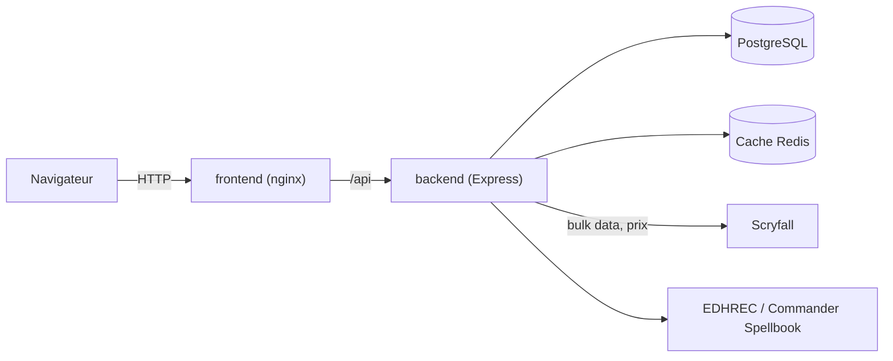

<div align="center">

# MTG Collector

**Inventaire, valorisation et construction de decks pour ta collection Magic: The Gathering, auto-hébergés.**

[](https://github.com/Exe64/mtg-collector/actions/workflows/ci.yml)
[](LICENSE)


[English](README.md) · Français


</div>

MTG Collector suit chaque carte que tu possèdes, jusqu'à l'édition, la
finition et l'état, la valorise chaque jour au prix Cardmarket via Scryfall,
et transforme cet inventaire en réponses : combien vaut ta collection, quel
commandant tu peux monter ce soir, ce qui te manque pour cette decklist. Elle
tourne sur ton propre serveur avec Docker Compose, pour toi et les personnes
que tu invites.

> L'interface est en français ; la recherche accepte les noms anglais et français.

## Fonctionnalités

### Collection

Recherche autocomplétée, toutes les éditions d'une carte, ajout ou retrait
des exemplaires normaux et foil en −/+. Filtres par type, rareté, couleur,
coût de mana, état et finition, groupement par extension, édition en ligne,
export CSV ou PDF.


### Détail carte

Image HD, texte oracle, prix et rulings officiels dans une seule modale.


### Commandants

Trouve un commandant parmi tous les légaux ou les légendes que tu possèdes,
filtré par couleur, coût de mana, type, appariement, prix et Game Changers,
trié selon EDHREC. **Ma collection** indique quelle part du deck moyen EDHREC
tu possèdes déjà et combien coûterait le reste. Un matchmaker en cinq
questions, les combos Commander Spellbook, les cartes phares et les
commandants similaires complètent chaque fiche.


### Decks

Importe une decklist (Moxfield, MTGO, `.txt` ou URL Moxfield), garde
l'édition et la finition exactes, et consulte courbe de mana, couleurs, prix
et cartes manquantes dans ta collection, à côté d'une decklist en trois
colonnes.


### Extensions et prix

Complétion par extension avec les numéros manquants, valeur possédée par
extension, mouvements de prix (hausses, baisses, variations sur une période)
et alertes de prix avec notifications dans l'application.


### Et aussi

- **Tableau de bord** : valeur en EUR et USD, évolution dans le temps, répartitions par couleur, rareté, état et type, top 10 des cartes.
- **Import / export** : CSV Moxfield, ManaBox (correspondance exacte par Scryfall ID) et générique, avec un emplacement de rangement par lot pour l'import en masse.
- **Wishlist** avec coût estimé, et **journal** de chaque ajout et retrait, avec annulation.
- **Multi-utilisateur** : collections isolées par compte, comptes créés par l'admin, double authentification TOTP optionnelle.
- **Administration** : état du système, dernières synchros et sauvegarde, jobs à la demande, réglages globaux, gestion des comptes.
- **PWA** : installable sur ordinateur et mobile, coquille de l'application disponible hors ligne.

<p align="center"> </p>

## Démarrage rapide

```bash
git clone https://github.com/Exe64/mtg-collector.git && cd mtg-collector
cp .env.example .env    # renseigner DB_PASSWORD, JWT_SECRET, JWT_REFRESH_SECRET, SCRYFALL_USER_AGENT
docker compose up -d --build
docker compose exec backend npm run sync:bulk
```

Ouvre `http://<ton-hôte>/` et inscris-toi : le premier compte devient
administrateur. Le guide complet, HTTPS compris, est dans
[doc/installation.md](doc/installation.md) (en anglais).

## Stack technique

| Couche | Technologie |
|---|---|
| Frontend | React 18, Vite, React Router, Zustand, servi par nginx |
| Backend | Node.js, Express 5, node-cron, pino |
| Données | PostgreSQL 16 (node-pg-migrate), Redis 8 |
| Données cartes | Bulk data et prix [Scryfall](https://scryfall.com), [EDHREC](https://edhrec.com), [Commander Spellbook](https://commanderspellbook.com) |
| Livraison | Docker Compose, GitHub Actions (lint, tests unitaires et d'intégration, build) |

Sécurité : access tokens JWT courts et refresh tokens httpOnly rotatés avec
détection de réutilisation, rate limiting étagé, CSP stricte, secrets validés
au démarrage, protection contre l'injection de formules CSV.

## Architecture



nginx sert l'application et relaie `/api` vers le backend sur la même
origine : pas de CORS, et le cookie de refresh reste httpOnly. Le backend
planifie lui-même ses jobs (prix toutes les 12 heures, synchro hebdomadaire
des cartes, cache commandants chaque nuit).

## Documentation

| Guide | Contenu |
|---|---|
| [Installation](doc/installation.md) | Prérequis, configuration, premier démarrage, HTTPS |
| [Exploitation](doc/operations.md) | Jobs planifiés, commandes manuelles, surveillance |
| [Sauvegardes](doc/backups.md) | Sauvegardes chiffrées hors machine, restauration, test de restauration |
| [API](backend/API.md) | Référence des endpoints REST |
| [Contribuer](CONTRIBUTING.md) · [Sécurité](SECURITY.md) | Comment contribuer, comment signaler une vulnérabilité |

## Licence

[GNU AGPL-3.0](LICENSE). Si tu fais tourner une version modifiée pour
d'autres personnes, tu dois publier tes modifications.

MTG Collector est un contenu de fan non officiel autorisé par la Fan Content
Policy de Wizards of the Coast. Il n'est ni approuvé ni soutenu par Wizards.
Certains éléments utilisés sont la propriété de Wizards of the Coast.
©Wizards of the Coast LLC. Données et images des cartes fournies par Scryfall.
