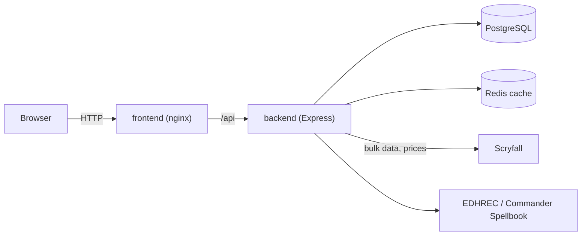

<div align="center">

# MTG Collector

**Self-hosted inventory, valuation and deck building for your Magic: The Gathering collection.**

[](https://github.com/Exe64/mtg-collector/actions/workflows/ci.yml)
[](LICENSE)


English · [Français](README.fr.md)


</div>

MTG Collector tracks every card you own, down to the printing, finish and
condition, prices it daily from Cardmarket through Scryfall, and turns that
inventory into answers: what your collection is worth, which commander you can
build tonight, and what is missing from that decklist. It runs on your own
server with Docker Compose, for you and the people you invite.

> The interface is in French; English and French card names are both searchable.

## Features

### Collection

Search with autocomplete, see every printing of a card and add or remove
regular and foil copies with −/+. Filter by type, rarity, colour, mana value,
condition and finish, group by set, edit inline, export to CSV or PDF.


### Card details

High-resolution image, oracle text, prices and official rulings in one modal.


### Commanders

Find a commander among every legal one or the legends you own, filtered by
colour, mana value, type, partner, price and Game Changers, sorted by EDHREC.
**My collection** shows how much of the average EDHREC deck you already own and
what completing it would cost. A five-question matchmaker, Commander Spellbook
combos, top cards and similar commanders complete each page.


### Decks

Import a decklist (Moxfield, MTGO, `.txt` or a Moxfield URL), keep the exact
printing and finish, and see mana curve, colours, price and what you are
missing from your collection, next to a three-column decklist.


### Sets and prices

Per-set completion with missing collector numbers, value owned per set, price
movements (gains, losses, variations over a period) and price alerts with
in-app notifications.


### And also

- **Dashboard**: value in EUR and USD, value over time, breakdowns by colour, rarity, condition and type, top 10 cards.
- **Import / export**: Moxfield, ManaBox (exact match on Scryfall ID) and generic CSV, with a storage-location tag per batch for bulk onboarding.
- **Wishlist** with estimated cost, and a **journal** of every addition and removal, with undo.
- **Multi-user**: isolated collections per account, accounts created by the admin, optional TOTP two-factor authentication.
- **Administration**: system status, last syncs and backup, on-demand jobs, global settings, account management.
- **PWA**: installable on desktop and mobile, works offline for the app shell.

<p align="center"> </p>

## Quick start

```bash
git clone https://github.com/Exe64/mtg-collector.git && cd mtg-collector
cp .env.example .env    # set DB_PASSWORD, JWT_SECRET, JWT_REFRESH_SECRET, SCRYFALL_USER_AGENT
docker compose up -d --build
docker compose exec backend npm run sync:bulk
```

Open `http://<your-host>/` and register: the first account becomes the
administrator. The full guide, HTTPS included, is in
[doc/installation.md](doc/installation.md).

## Tech stack

| Layer | Technology |
|---|---|
| Frontend | React 18, Vite, React Router, Zustand, served by nginx |
| Backend | Node.js, Express 5, node-cron, pino |
| Data | PostgreSQL 16 (node-pg-migrate), Redis 8 |
| Card data | [Scryfall](https://scryfall.com) bulk data and prices, [EDHREC](https://edhrec.com), [Commander Spellbook](https://commanderspellbook.com) |
| Delivery | Docker Compose, GitHub Actions (lint, unit and integration tests, build) |

Security: short-lived JWT access tokens with rotated httpOnly refresh tokens
and reuse detection, tiered rate limiting, strict CSP, secrets validated at
boot, CSV formula injection guard.

## Architecture



nginx serves the app and proxies `/api` to the backend on the same origin, so
there is no CORS and the refresh cookie stays httpOnly. The backend runs its
own scheduled jobs (prices every 12 hours, weekly card sync, nightly
commander cache).

## Documentation

| Guide | Content |
|---|---|
| [Installation](doc/installation.md) | Requirements, configuration, first start, HTTPS |
| [Operations](doc/operations.md) | Scheduled jobs, manual commands, monitoring |
| [Backups](doc/backups.md) | Encrypted off-site backups, restore and restore drill |
| [API](backend/API.md) | REST endpoint reference |
| [Contributing](CONTRIBUTING.md) · [Security](SECURITY.md) | How to contribute, how to report a vulnerability |

## License

[GNU AGPL-3.0](LICENSE). If you run a modified version for others, you must
publish your changes.

MTG Collector is unofficial Fan Content permitted under the Wizards of the
Coast Fan Content Policy. It is not approved or endorsed by Wizards. Portions
of the materials used are property of Wizards of the Coast. ©Wizards of the
Coast LLC. Card data and images are provided by Scryfall.
